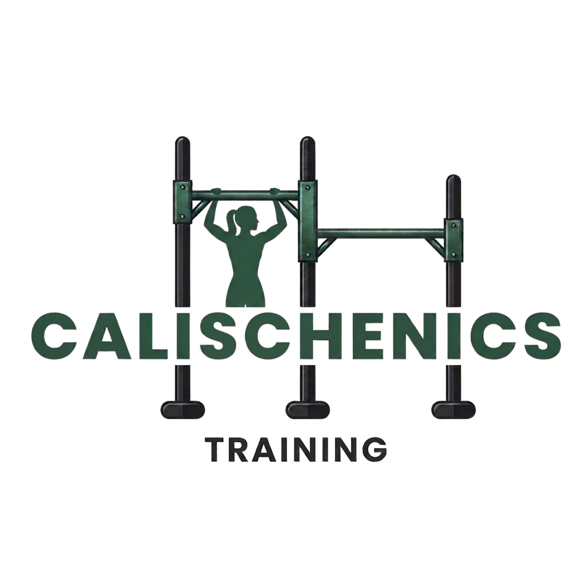
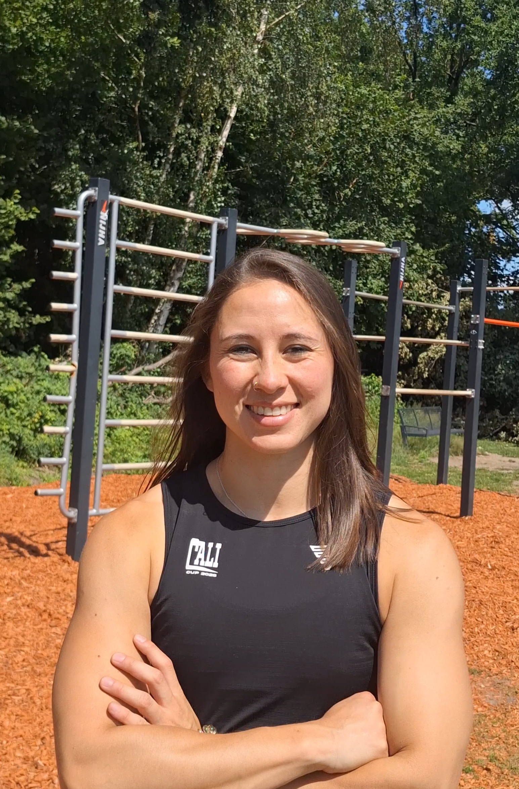

```{=html}
<style>
  :root {
    --green-dark: #2f5446;
    --green-sage: #7a9a86;
    --slate: #456b7a;
    --bg: #d9d9d9;
    --card: #ffffff;
    --text: #2b2b2b;
  }

  * { box-sizing: border-box; }
  html { scroll-behavior: smooth; }

  body {
    margin: 0;
    background: var(--bg);
    color: var(--text);
    font-family: 'Josefin Sans', 'Gill Sans', Helvetica, Arial, sans-serif;
    font-weight: 400;
    line-height: 1.65;
    font-size: 1.05rem;
  }

  /* Quarto wrappers: remove default spacing */
  #quarto-content, .page-columns, main.content { padding: 0 !important; margin: 0 !important; max-width: none !important; display: block !important; }
  header#title-block-header { display: none; }

  a { color: var(--green-dark); }

  /* ---------- NAV ---------- */
  .nav {
    position: sticky; top: 0; z-index: 50;
    display: flex; justify-content: center; align-items: center; gap: 2rem;
    padding: .8rem 1rem;
    background: rgba(217,217,217,.92);
    backdrop-filter: blur(6px);
  }
  .nav a {
    text-decoration: none; color: var(--green-dark);
    font-weight: 600; letter-spacing: .08em; text-transform: uppercase; font-size: .85rem;
  }
  .nav a:hover { color: var(--slate); }
  .nav img { height: 38px; width: auto; }

  /* ---------- HERO ---------- */
  .hero {
    position: relative;
    text-align: center;
    padding: 5rem 1.5rem 7rem;
    background: var(--green-dark);
    overflow: hidden;
  }
  .hero .waves {
    position: absolute; inset: 0; width: 100%; height: 100%; z-index: 0;
  }
  .hero-inner { position: relative; z-index: 1; max-width: 900px; margin: 0 auto; }
  .logo-big { height: 120px; width: auto; margin-bottom: 1.2rem; filter: drop-shadow(0 2px 6px rgba(0,0,0,.25)); }
  .title-pill {
    display: inline-block;
    background: #fff;
    border-radius: 999px;
    padding: .5rem 2.8rem;
    font-family: 'Cinzel', Georgia, serif;
    font-weight: 700;
    font-size: clamp(1.6rem, 5vw, 3rem);
    letter-spacing: .12em;
    text-transform: uppercase;
    color: #111;
    margin: 0;
  }
  .tagline {
    color: #fff; font-weight: 300; font-size: 1.25rem;
    margin: 1.5rem auto 2rem; max-width: 560px;
  }
  .btn {
    display: inline-block;
    padding: .75rem 1.8rem;
    border-radius: 999px;
    background: #fff; color: var(--green-dark);
    text-decoration: none; font-weight: 600; letter-spacing: .06em;
    transition: transform .15s ease, background .15s ease, color .15s ease;
    border: 2px solid #fff;
  }
  .btn:hover { transform: translateY(-2px); background: var(--green-sage); color: #fff; border-color: var(--green-sage); }
  .btn.dark { background: var(--green-dark); color: #fff; border-color: var(--green-dark); }
  .btn.dark:hover { background: var(--slate); border-color: var(--slate); }
  .btn.outline { background: transparent; color: var(--green-dark); border-color: var(--green-dark); }
  .btn.outline:hover { background: var(--green-dark); color: #fff; }

  /* ---------- SECTIONS ---------- */
  section.block { max-width: 1000px; margin: 0 auto; padding: 4rem 1.5rem 1rem; }
  .pill-heading {
    display: block; width: fit-content;
    background: var(--green-dark); color: #fff;
    border-radius: 999px;
    padding: .55rem 2.6rem;
    font-weight: 400; font-size: 1.5rem; letter-spacing: .04em;
    margin: 0 0 1.8rem 0;
  }
  .card {
    background: var(--card);
    border-radius: 22px;
    padding: 2rem 2.2rem;
    box-shadow: 0 2px 10px rgba(0,0,0,.05);
  }

  /* ---------- ABOUT ---------- */
  .about-grid { display: grid; grid-template-columns: 1fr 1.4fr; gap: 2rem; align-items: stretch; }
  .about-photo {
    border-radius: 22px; overflow: hidden; min-height: 340px;
    background: linear-gradient(135deg, var(--slate), var(--green-sage));
  }
  .about-photo img { width: 100%; height: 100%; object-fit: cover; display: block; }
  .about-text h3 { margin: 0 0 .4rem; font-family: 'Cinzel', serif; letter-spacing: .06em; color: var(--green-dark); }
  .mission {
    margin-top: 1.4rem; padding-top: 1.2rem;
    border-top: 2px solid var(--bg);
  }
  .mission strong { color: var(--green-dark); }
  .tags { display: flex; flex-wrap: wrap; gap: .5rem; margin-top: 1.2rem; }
  .tags span {
    background: var(--bg); border-radius: 999px; padding: .2rem .9rem;
    font-size: .85rem; font-weight: 600; color: var(--green-dark);
  }

  /* ---------- EVENTS ---------- */
  .events-grid { display: grid; grid-template-columns: repeat(auto-fit, minmax(260px, 1fr)); gap: 1.5rem; }
  .event {
    background: var(--card); border-radius: 22px; overflow: hidden;
    display: flex; flex-direction: column;
    text-decoration: none; color: inherit;
    box-shadow: 0 2px 10px rgba(0,0,0,.05);
    transition: transform .2s ease, box-shadow .2s ease;
  }
  .event:hover { transform: translateY(-4px); box-shadow: 0 8px 20px rgba(0,0,0,.12); }
  .thumb {
    aspect-ratio: 16 / 10; width: 100%;
    background: linear-gradient(135deg, var(--green-sage), var(--slate));
  }
  .thumb img { width: 100%; height: 100%; object-fit: cover; display: block; }
  .event-body { padding: 1.2rem 1.4rem 1.5rem; display: flex; flex-direction: column; gap: .3rem; flex: 1; }
  .event-date { font-size: .8rem; font-weight: 600; letter-spacing: .1em; text-transform: uppercase; color: var(--slate); }
  .event h3 { margin: 0; font-size: 1.2rem; color: var(--green-dark); }
  .event p { margin: 0; font-size: .95rem; }
  .event .more { margin-top: auto; padding-top: .8rem; font-weight: 600; color: var(--green-dark); }

  /* ---------- COACHING ---------- */
  .coaching-grid { display: grid; grid-template-columns: 1fr 1fr; gap: 1.5rem; }
  .card h3 { margin-top: 0; color: var(--green-dark); font-family: 'Cinzel', serif; letter-spacing: .05em; }
  .contact-list { list-style: none; padding: 0; margin: 1rem 0 1.4rem; }
  .contact-list li { padding: .35rem 0; }
  .contact-list a { font-weight: 600; text-decoration: none; border-bottom: 2px solid var(--green-sage); }
  .contact-list a:hover { color: var(--slate); }

  /* ---------- FOOTER ---------- */
  footer.site {
    margin-top: 5rem; padding: 2.5rem 1rem 3rem; text-align: center;
    background: var(--green-dark); color: #fff;
  }
  footer.site img { height: 70px; width: auto; margin-bottom: .6rem; }
  footer.site p { margin: .2rem 0; font-weight: 300; font-size: .9rem; opacity: .9; }

  @media (max-width: 760px) {
    .about-grid, .coaching-grid { grid-template-columns: 1fr; }
    .about-photo { min-height: 260px; }
    .nav { gap: 1rem; }
    .card { padding: 1.5rem; }
  }
</style>

<!-- ============ NAV ============ -->
<nav class="nav">
  
  <a href="#about">About</a>
  <a href="#events">Events</a>
  <a href="#coaching">Coaching</a>
</nav>

<!-- ============ HERO ============ -->
<header class="hero">
  <svg class="waves" viewBox="0 0 1200 500" preserveAspectRatio="none" xmlns="http://www.w3.org/2000/svg" aria-hidden="true">
    <path d="M0,0 H1200 V120 C1000,200 800,40 600,100 C400,160 200,60 0,150 Z" fill="#7a9a86" opacity=".85"/>
    <path d="M0,0 H1200 V60 C1000,110 850,10 650,50 C450,90 250,20 0,80 Z" fill="#456b7a" opacity=".9"/>
    <path d="M0,500 H1200 V420 C1000,380 800,470 600,430 C400,390 200,460 0,410 Z" fill="#7a9a86" opacity=".35"/>
  </svg>
  <div class="hero-inner">
    
    <h1 class="title-pill">Calischenics Training</h1>
    <p class="tagline">Build strength. Master your bodyweight. Move with confidence.</p>
    <a class="btn" href="#coaching">Train with me</a>
  </div>
</header>

<!-- ============ ABOUT ============ -->
<section class="block" id="about">
  <h2 class="pill-heading">About me</h2>
  <div class="about-grid">
    <div class="about-photo">
      
    </div>
    <div class="card about-text">
      <h3>Hi, I'm Rebecca!</h3>
      <p>
        I'm a calisthenics coach passionate to help people get stronger,
        learn new skills and enjoy movement From your first pull-up to your first muscle-up,
        I build programs that fit your level, your goals and your life.
      </p>
      <div class="mission">
        <strong>My mission</strong>
        <p>
          To grow calisthenics as a sport and to make calisthenics accessible to everyone, so you can build lasting strength with nothing but minimal equipment and your own body.
        </p>
      </div>
      <div class="tags">
        <span>Pull-ups</span><span>Dips</span><span>Muscle-up</span><span>Handstand</span><span>Mobility</span>
      </div>
    </div>
  </div>
</section>

<!-- ============ EVENTS ============ -->
<section class="block" id="events">
  <h2 class="pill-heading">Events</h2>
  <div class="events-grid">

    <a class="event" href="https://example.com/event-1" target="_blank" rel="noopener">
      <div class="thumb"></div>
      <div class="event-body">
        <span class="event-date">Date · Location</span>
        <h3>Muscle-up Workshop</h3>
        <p>Learn the swing, the knee drive and the transition in a small group.</p>
        <span class="more">More info &rarr;</span>
      </div>
    </a>

    <a class="event" href="https://example.com/event-2" target="_blank" rel="noopener">
      <div class="thumb"></div>
      <div class="event-body">
        <span class="event-date">Date · Location</span>
        <h3>Outdoor Training Day</h3>
        <p>A relaxed session at the park for all levels. Bring water and a friend.</p>
        <span class="more">More info &rarr;</span>
      </div>
    </a>

    <a class="event" href="https://example.com/event-3" target="_blank" rel="noopener">
      <div class="thumb"></div>
      <div class="event-body">
        <span class="event-date">Date · Location</span>
        <h3>Beginner Bootcamp</h3>
        <p>Your first steps in calisthenics: pull-ups, push-ups, dips and core.</p>
        <span class="more">More info &rarr;</span>
      </div>
    </a>

  </div>
</section>

<!-- ============ COACHING ============ -->
<section class="block" id="coaching">
  <h2 class="pill-heading">Coaching</h2>
  <div class="coaching-grid">

    <div class="card">
      <h3>Work with me</h3>
      <p>
        Personal programs, technique feedback and accountability, online or in person.
        Tell me about your goals and we'll find the right plan together.
      </p>
      <ul class="contact-list">
        <li>✉️ <a href="mailto:rschen96@gmail.com">rschen96@gmail.com</a></li>
        <li>📷 <a href="https://instagram.com/calischenics_nl" target="_blank" rel="noopener">@calischenics_nl</a></li>
      </ul>
      <a class="btn dark" href="mailto:rschen96@gmail.com?subject=Coaching%20inquiry">Get in touch</a>
    </div>

    <div class="card">
      <h3>Programs &amp; products</h3>
      <p>
        Prefer to train at your own pace? Check out my training programs, guides and
        resources in the shop.
      </p>
      <br>
      <a class="btn outline" href="https://example.com/shop" target="_blank" rel="noopener">Check out my guides and coaching options &rarr;</a>
    </div>

  </div>
</section>

<!-- ============ FOOTER ============ -->
<footer class="site">
  
  <p>Calischenics Coaching · Rebecca Chen</p>
  <p>&copy; 2026 · All rights reserved</p>
</footer>
```
